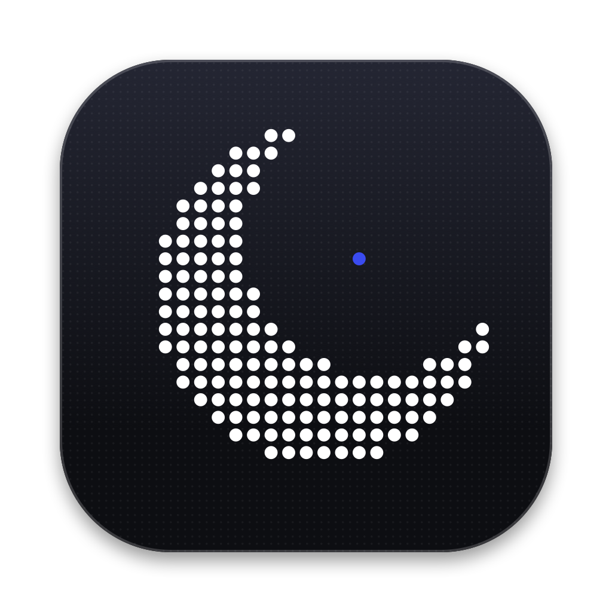

# Sleepy

A sleep timer that lives in the Mac menu bar. Pick a length or a time, and when it runs out
Sleepy pauses what's playing and puts the Mac to sleep. Ten minutes before, a small card
lets you extend or cancel.

- One-tap lengths: 15, 30, 45, 60, 90, 120 minutes, or type your own (`75`, `1:30`, `1h 30m`)
- Desktop widget: a live countdown with quick starts that sits on your desktop
- Sleep at a set time (23:30), with the time left shown as "IN 19H10"
- Repeating schedules by weekday (Weeknights 23:00 for 1 h, and so on)
- Heads-up card with **Extend 10 min** and **Cancel**
- Countdown next to the moon in the menu bar
- Spotlight, Siri and Shortcuts actions, plus a `sleepy://` URL scheme
- No network access. Sleepy never connects to the internet.

Requires macOS 26 or later.

## Build

You don't need Xcode; the Command Line Tools are enough (`xcode-select --install`).

```sh
scripts/build-app.sh          # → build/Sleepy.app
open build/Sleepy.app
scripts/test.sh               # unit tests
```

Move `Sleepy.app` to `/Applications` before you turn on **Open at login**.

## Spotlight and Siri

Sleepy defines these App Intents (`Sources/Sleepy/Intents/SleepyIntents.swift`):

| Say or type in Spotlight             | Does                         |
| ------------------------------------ | ---------------------------- |
| `Sleepy 45 minutes`                  | Starts a 45-minute timer     |
| `Set Sleepy to sleep at a time`      | Sleeps at a time of day      |
| `How much time left on Sleepy?`      | Tells you the time left      |
| `Stop Sleepy`                        | Cancels the timer            |

**Limitation:** macOS finds App Intents through metadata that Xcode generates at build time.
The Command Line Tools build above doesn't produce it, so **these actions don't show up in
Spotlight or Shortcuts** in that build. To get them, build the `Sleepy` target in Xcode, or
add Xcode's `appintentsmetadataprocessor` step to the script.

The URL scheme works in every build. You can use it from Terminal, Raycast, Alfred or a
Shortcuts "Open URL" action:

```sh
open "sleepy://start?minutes=45"
open "sleepy://at?time=23:30"
open "sleepy://extend?minutes=10"
open "sleepy://stop"
```

## Desktop widget

The widget is a panel that Sleepy draws itself, behind your windows on every desktop. Drag it
wherever you like; it remembers its spot. Turn it off in Settings → General.

It isn't in the macOS widget gallery. A gallery widget needs a signed app extension, and its
buttons need App Intents metadata, so that requires an Xcode build. Sleepy has to be running
for its widget to show.

## How it puts the Mac to sleep

Sleepy asks Music, TV, Spotify, Podcasts and QuickTime to pause, but only the ones that are
running. The first time it does this, macOS asks you to allow automation. Then Sleepy runs
`pmset sleepnow`. It needs no admin rights and no helper tools.

Schedules start only while Sleepy is running. Turn on **Open at login** so they keep working.

## Development flags

```sh
open build/Sleepy.app --args -demoSpeed 60 -dryRun YES
```

- `-demoSpeed 60` runs the timer 60 times faster.
- `-dryRun YES` beeps instead of sleeping.
- `-preview YES` opens the menu panel and heads-up card in their own windows.

## Icon

The moon is defined once, in `Sources/SleepyCore/MoonDots.swift`. The menu bar draws it live.
After changing the shape, run `scripts/make-icon.sh` to regenerate the app icon.

## Layout

- `Sources/SleepyCore`: schedule math, time formatting and URL parsing, all unit-tested.
- `Sources/Sleepy`: the SwiftUI app (menu bar panel, settings, heads-up card, intents).

## License

MIT
